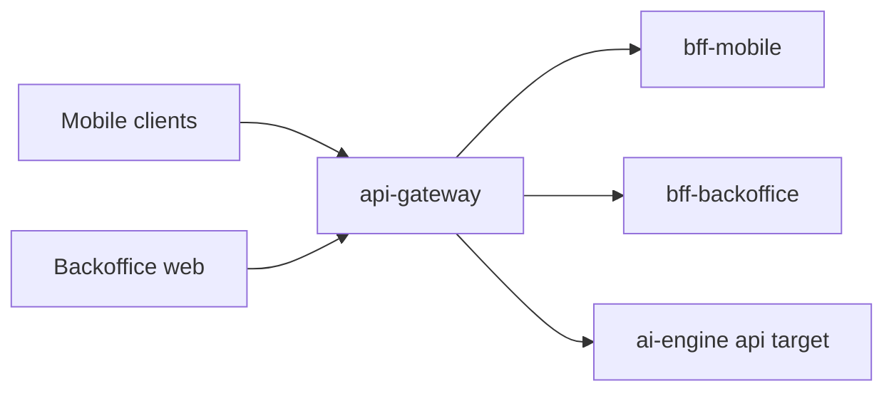

# api-gateway

Last updated: 2026-05-08.

Single edge gateway for AxiomNode public traffic.

## Responsibility

`api-gateway` is the public edge boundary for the platform. It is responsible for exposing stable public routes while keeping downstream services private and replaceable.

In the current staging topology it also acts as the live runtime holder for the active `ai-engine` upstream when the engine runs outside the cluster.

## Runtime role

### Runtime context

### Main responsibilities

- Expose a unified entry point for mobile and backoffice clients.
- Apply edge concerns: auth, CORS, rate limits, and request tracing.
- Route requests to channel-specific BFF services.
- Provide the stable internal ai-engine upstream used by cluster services when ai-engine runs externally on an optional workstation.

## Runtime surface

### Concrete upstream model

`api-gateway` has three distinct forwarding roles:

1. client edge routing toward `bff-mobile`
2. client edge routing toward `bff-backoffice`
3. internal ai-engine proxying toward the configured AI API and stats URLs

That third role matters operationally because the gateway can expose stable internal AI routes while the AI upstream host is changed through configuration.

Route inventory and forwarding semantics are documented in the local docs and in the public-edge capability dossier so this README can stay focused on repository role.

Plain forwarding routes use the shared SDK raw passthrough (`forwardHttpRaw`): request and response bodies travel as the original bytes, with no JSON parse/serialize at the gateway, and the upstream timeout covers reading the body. Routes that validate input (mobile quiz/word-pass random, backoffice leaderboard) keep the JSON mode.

Backoffice role routes are forwarded without owning role policy. `GET /v1/backoffice/admin/users/roles` can be used by `SuperAdmin` and `Inspector` after downstream validation, while role mutation remains a `SuperAdmin` operation in `microservice-users`.

## Local setup

### Repository structure

- `src/`: Fastify + TypeScript implementation.
- `docs/`: architecture, guides, and operations notes.
- `.github/workflows/ci.yml`: repository CI and deployment dispatch trigger.

### Primary use cases

- route public mobile requests toward `bff-mobile`
- route protected backoffice requests toward `bff-backoffice`
- proxy internal ai-engine traffic toward the configured ai-engine API and stats URLs
- expose health checks

### Local development

1. `cd src`
2. `cp .env.example .env`
3. `npm install`
4. `npm run dev`

### Route note

The gateway owns public `/v1/mobile/*`, `/v1/backoffice/*`, and internal `/internal/ai-engine/*`. See `docs/architecture/README.md` and the edge capability dossier for the concrete inventory.

### Upstream resolution

The BFF and ai-engine upstreams are resolved from environment configuration only (`BFF_MOBILE_URL`, `BFF_BACKOFFICE_URL`, `AI_ENGINE_API_URL`, `AI_ENGINE_STATS_URL`); the gateway keeps no runtime override or persisted routing state.

## Documentation

- `docs/README.md`
- `docs/architecture/README.md`
- `docs/guides/README.md`
- `docs/operations/README.md`

## Dependencies and contracts

### Dependency surface

Primary downstream dependencies:

- `bff-mobile`
- `bff-backoffice`
- active `ai-engine-api` target
- active `ai-engine-stats` target

## Deployment and operations notes

### Operational constraints

- `api-gateway` images are published to GHCR by the `platform-infra` build workflow; the former automatic GHCR-to-k3s staging rollout is disabled (the k3s host no longer exists and `deploy.yaml` is manual-only).
- The gateway image can be redeployed independently from the actual ai-engine runtime location.
- When `ai-engine` is externalized, a healthy gateway rollout does not by itself guarantee healthy ai-engine connectivity; `AI_ENGINE_API_URL` and `AI_ENGINE_STATS_URL` must also point at the real runtime.

### CI/CD and rollout note

CI behavior is documented in `docs/operations/README.md` and `../docs/operations/cicd-workflow-map.md`.

### Failure boundaries

- edge policy failure before forwarding
- BFF reachability failure
- ai-engine target points to an unreachable or wrong upstream
- upstream timeout or slow-response degradation

### Repository-local documentation scope

This repository should stay concrete about:

- exposed edge and internal AI routes
- upstream resolution from environment configuration
- repo-local CI and deployment gates

### Key environment variables

- `ALLOWED_ORIGINS`
- `BFF_MOBILE_URL`
- `BFF_BACKOFFICE_URL`
- `EDGE_API_TOKEN`
- `AI_ENGINE_API_URL`
- `AI_ENGINE_STATS_URL`
- `INTERNAL_SERVICE_TOKEN`
- `TRUST_PROXY`

### Security defaults (fail closed)

- Outside `NODE_ENV=development|test`, the gateway refuses to start when `EDGE_API_TOKEN` or `INTERNAL_SERVICE_TOKEN` is empty. In development/test an empty token leaves the matching routes open and a warning is logged at startup.
- Tokens are compared in constant time.
- `/internal/ai-engine/*` routes require the `x-internal-token` header to equal `INTERNAL_SERVICE_TOKEN`. Service callers (producers, operators) must send it. These routes must not be exposed by the public ingress.
- `TRUST_PROXY` controls which `X-Forwarded-For` hops are trusted when deriving the client IP used by the rate limiter. The default (`false`) ignores the header, so behind an ingress every client shares the ingress IP bucket: set it to the ingress CIDR(s), or `true`/a hop count when the gateway is reachable only through the proxy.

## References

- `docs/architecture/`
- `docs/operations/`
- `../docs/guides/capabilities/edge/public-edge-routing.md`
- `../docs/operations/cicd-workflow-map.md`
